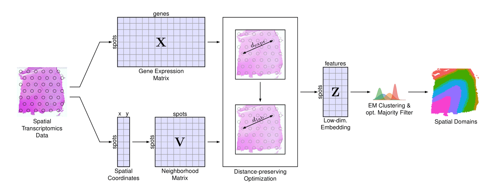

# DOST: Distance-preserving Optimization for Spatial Transcriptomics

**DOST** is an R package for identifying spatial domains in spatial transcriptomics (ST) data. It is a distance-preserving optimization based method that clusters ST spots into spatial domains. DOST embeds ST spots into a low-dimensional space using a Sammon mapping inspired loss function that jointly preserves gene expression similarity and spatial smoothness.

{width=100%}

## Installation

You can install the development version of DOST from [GitHub](https://github.com/) with:

``` r
# install.packages("devtools")
devtools::install_github("misratasci/DOST")

```

## Documentation & Tutorials

For a full reproduction of the spatial domain identification of the DLPFC dataset from our paper, please see the [DLPFC Vignette](https://misratasci.github.io/DOST/articles/DLPFC.html).

Tutorials for the BC, DLPFC, mHypothalamus, mMAMP and mPFC datasets are in
[`tutorials/`](tutorials/). The scripts that reproduce every result and figure
of the paper, including the baseline methods, are in
[`reproducibility/`](reproducibility/).

## Citation

If you use DOST, please cite it as in [`CITATION.cff`](CITATION.cff).

## License

DOST is released under the GPL-3 license (see [`LICENSE.md`](LICENSE.md)). Third-party
code in `reproducibility/` keeps its original license; see
[`THIRD_PARTY_NOTICES.md`](THIRD_PARTY_NOTICES.md).
